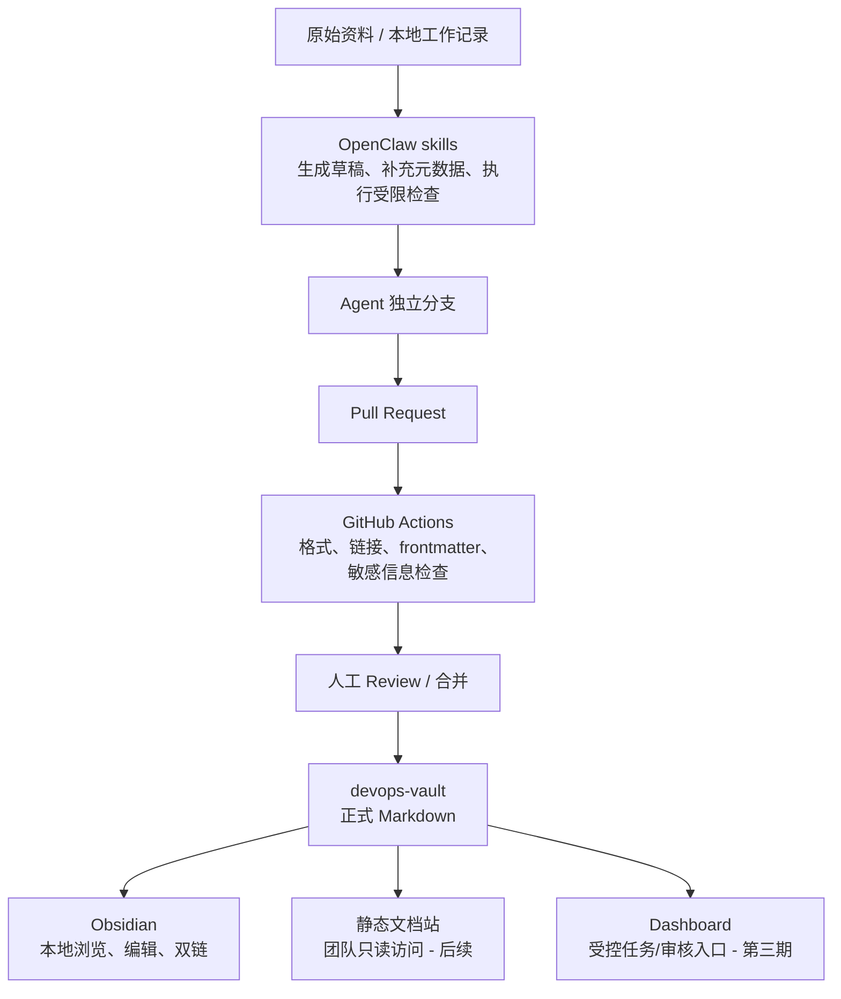
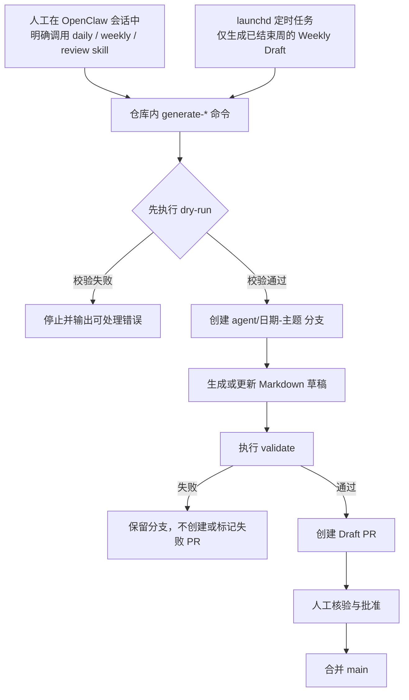

# DevOps Vault：Git 托管与自动化开发计划

> **已归档：** 本文描述的 OpenClaw/launchd 方案已于 2026-11-17 停用，仅保留用于历史追溯。当前方案见 [Quartz 发布实施计划](../2026-11-11-devops-vault-quartz-migration-plan.md)。

## 1. 背景与目标

当前本地工作流为 OpenClaw skills 生成 review、日报、周报等 Markdown，再由 Obsidian 管理 daily、weekly、wiki 等资料。它已经能服务个人知识沉淀，但存在以下不足：

- 文档仅在本机，缺少可恢复的版本历史、跨设备同步和协作入口；
- 部分生成、归档、检查和发布步骤仍需人工执行；
- AI 生成内容没有统一的来源、审核、变更记录和合并边界；
- 后续若面向团队开放，需要权限、审计和异步任务的治理能力。

本计划将本仓库作为**正式知识产物的 Git 单一事实来源（source of truth）**，保留 OpenClaw + Obsidian 的本地体验，并以 Pull Request 建立 AI 生成内容的审核闸门。

## 2. 已确认的架构决策

### 2.1 组件职责



| 组件 | 本期职责 | 不承担的职责 |
| --- | --- | --- |
| GitHub 私有仓库 | 正式文档、版本、PR、审批、CI | 存储密钥、替代对象存储、直接运行本地 Agent |
| OpenClaw | 按模板生成草稿、调用检查、创建分支/PR | 无审核直写 `main`、替代权限系统 |
| Obsidian | Markdown 本地编辑、检索、双向链接 | 团队权限、自动审批、自动部署 |
| GitHub Actions | 文档校验、敏感信息扫描、预览构建 | 承载本机私密资料、直接访问个人桌面环境 |
| Dashboard（后续） | 权限、任务登记、审核、审计、跳转链接 | 重造 Markdown 编辑器或嵌入 LLM Wiki 源码 |

### 2.2 LLM Wiki 的边界

`nashsu/llm_wiki` 可作为独立的本地“资料加工与检索实验层”：将原始资料整理为有来源的 Wiki、提供图谱和本地 API/MCP 检索。它不是团队协作平台，也不是 OpenClaw + Obsidian 整条链路的替代品。

本仓库不 fork、不改造、不嵌入其源码。原因是其桌面/单机定位与本计划的 Git/PR 协作模型不同，且其 GPLv3 许可证在未来 Dashboard 深度集成时需要单独法务评估。若试用，仅让 Agent 通过其本地 API 进行受控的只读检索；正式写入依旧走本仓库 PR。

### 2.3 安全与数据分类

从第一期开始区分以下资料，禁止混放：

| 类别 | 存放位置 | 规则 |
| --- | --- | --- |
| 个人资料 | 独立私有 Vault 或本机受控目录 | 不自动进入团队仓库 |
| 团队可共享资料 | 本仓库 | 允许协作、PR 和文档站发布 |
| 敏感运维资料 | 私有 Vault；凭证材料仍存受控密钥系统 | 允许提交凭证脱敏后的完整 Review 源文档；不得提交密钥、Token、私钥、密码、Authorization 值、完整敏感请求载荷或客户数据 |

所有 AI 外发前必须执行脱敏和数据边界检查；生成记录保存模型/skill 版本和来源，但不能将密钥或完整敏感 prompt 写入 Git、Issue、PR 描述或日志。

## 3. 目标目录契约

第一期完成后仓库应采用以下目录，路径与命名规则作为自动化输入/输出契约：

```text
devops-vault/
├── README.md
├── docs/                         # 架构、流程、开发计划
├── inbox/                        # 待加工的凭证脱敏输入；不作为正式知识
├── sources/                      # 凭证脱敏的完整 Review 源文档与证据链
├── daily/YYYY/MM/YYYY-MM-DD.md   # 每日记录
├── weekly/YYYY/YYYY-Www.md       # 周报
├── reviews/YYYY/YYYY-MM-DD-*.md  # Review、复盘、专题结论
├── wiki/                         # 稳定主题知识页，使用 wikilink + frontmatter
├── templates/                    # Daily、Weekly、Review、Wiki 模板
├── scripts/                      # 可审计的本地自动化入口
└── .github/
    ├── workflows/                # PR 校验和文档预览
    ├── pull_request_template.md
    └── CODEOWNERS
```

建议每个正式页面使用最小 YAML frontmatter：

```yaml
title: 示例标题
created: 2026-09-25
updated: 2026-09-25
status: draft # draft | review | published | archived
owners: [liuzelin]
sources: []
generated:
  tool: openclaw
  skill: example-skill
  skill_version: null
  reviewed_by: null
```

`generated` 不是强制 AI 标记；纯人工页面可省略。`sources` 用仓库内相对路径、外部稳定链接或凭证脱敏后的工单/事件/Review 源文档引用。私有 Vault 是团队维护的单一事实来源，但不得复制认证材料。

## 4. 三期实施计划

### 第一期：Git 化与可审核生成

### 目标

在不迁移所有历史 Vault 的前提下，建立一条从本地生成到 GitHub PR 的最小可靠链路。

### 工作项

1. 建立目录、模板、`.gitignore`、资料分类说明和贡献规范。
2. 创建 `scripts/` 下的显式入口：
   - `generate-daily`：按模板生成当天草稿；
   - `generate-weekly`：汇总目标周内已合并的 Daily 与 Review，生成周报草稿；
   - `generate-review`：以输入资料生成 Review 草稿；
   - `validate`：本地运行与 CI 等价的格式、链接、frontmatter、敏感内容检查。
3. 为每次 Agent 生成创建独立分支，命名为 `agent/<yyyy-mm-dd>-<topic>`；禁止 Agent 向 `main` push。
4. 配置 PR 模板，至少要求说明：资料来源、生成方式、敏感信息检查结果、人工核验项、预期归档路径。
5. 配置 GitHub Actions：Markdown 格式、断链、frontmatter、秘密扫描和变更范围检查。检查失败不得合并。
6. 配置分支保护：`main` 至少需要通过 CI；review、wiki 和批量修改需要人工批准。Daily 可在后续依据质量数据决定是否降低审核级别。
7. Daily、Review 和 Wiki 只能由人工在 OpenClaw 会话中触发。`launchd` 或其他本机调度器仅可用于 Weekly Draft PR，且只能调用仓库内受限入口；不得在 GitHub-hosted Runner 上执行本机 skill。

### 触发模型

首期采用**Daily/Review/Wiki 仅人工触发、Weekly 同时支持人工与定时触发**的模型。两种 Weekly 入口都只能调用同一个仓库内生成脚本，产物均创建独立分支和 PR，不能因入口不同绕过审核。



| 文档类型 | 首选触发方式 | `launchd` 是否允许 | 合并策略 |
| --- | --- | --- | --- |
| Daily | 人工在 OpenClaw 会话中触发 | 否 | 必须人工审核 |
| Weekly | 人工触发，或定时生成上一完整周的 Draft PR | 可，每周一次 | 必须人工审核 |
| Review / 复盘 | 人工在指定 OpenClaw 会话中触发 | 否 | 必须人工审核 |
| Wiki 整理 | 人工触发，或第二期实验层处理后回写 | 否 | 必须人工审核 |

`launchd` 的职责是**准时发起一个有限、幂等的 Weekly Draft 任务**，例如“生成上一完整 ISO 周的周报草稿并创建 Draft PR”；它不是常驻 Agent，也不应自行判断 Daily、事故结论、写 Review 或批准合并。人工会话触发适用于需要补充上下文、选择资料来源或确认结论的任务。

### 首期验收标准

- 新 Daily 能从本机生成、经过校验、以 PR 合并到 `main`；
- 任意提交可追溯到来源、作者/Agent、审核人和合并 commit；
- 敏感信息检测命中时 CI 失败，且不会自动外传文件内容；
- 本机 Obsidian 可直接打开仓库，且 `.obsidian/workspace*` 等个人状态不进入版本控制；
- 失败的生成不会污染 `main`，可从分支/PR 安全重试。

### 当前 GitHub 平台限制与补偿控制

截至 2026-09-25，本仓库为私有仓库，当前 GitHub 套餐不支持分支保护 API；无法在 GitHub 上强制 required checks 或 PR review。仓库必须保持私有，不能为了获得该能力而公开运维知识。

在升级到支持私有仓库分支保护的 GitHub 套餐、迁移到具备 Protected Branch 的 GitLab，或迁入具备相应策略的组织前，采用以下临时控制：

1. Agent、定时任务和人工流程均约定禁止直接向 `main` push；
2. 所有生成内容一律先创建 Draft PR，合并前人工查看 Actions 结果；
3. `reviews/`、`wiki/` 和 `docs/` 由 `CODEOWNERS` 标识负责人，但该标识当前不具备强制力；
4. 每次合并前核验 `Validate vault content` workflow 成功；
5. 将直接写入 `main` 视为流程违规并在审计记录中说明原因。

### 非目标

- 不在本期导入全部历史笔记；仅迁移已确认需要长期保留且完成分类的文档。
- 不建设团队在线编辑器、图谱服务或 Dashboard 页面。
- 不让任何自动化拥有绕过 PR 的生产写权限。

### 第二期：知识加工试点与团队只读消费

### 目标

在不影响正式 Vault 稳定性的前提下，验证自动结构化、图谱和检索是否带来实际收益。

### 工作项

1. 建立独立实验 Vault，仅导入公开资料、脱敏复盘或历史项目文档；不得和正式 Vault 双向自动同步。
2. 试用 LLM Wiki：关注来源准确率、实体拆分质量、图谱可用性、增量处理成本和资料泄露边界。
3. 若使用其 `llm-wiki` skill/API，限制为本机、携带 API Token、默认只读；应用未运行或 API 不可用时，OpenClaw 必须降级为普通 Markdown 检索而非失败重试。
4. 对确认有价值的输出生成 PR 回写至 `wiki/`；不允许实验应用直接修改正式 `main`。
5. 为团队建立静态只读文档预览（例如受访问控制的 Pages 或内部站点），发布源只能是已合并的 `main`。
6. 以四周试点数据评估：人工修订率、来源可追溯率、检索命中质量、平均生成耗时/成本、团队实际访问率。

### 第二期验收标准

- 实验 Vault 与正式 Vault 的文件和凭据边界清晰，无双向写入；
- 每篇从实验层进入正式知识库的页面都有来源和人工确认；
- 团队成员能只读访问已发布版本，不能看到个人或未合并草稿；
- 有数据支撑是否继续保留图谱/向量检索能力，而非因功能丰富默认上线。

### 第三期：Dashboard 受控入口

### 目标

将 Dashboard 作为团队工作流入口，而不是知识编辑器或 LLM Wiki 的替代实现。

### 推荐最小能力

1. 文档任务登记：选择模板、来源分类、目标路径、敏感等级和生成请求。
2. 异步任务视图：排队、运行、失败、重试、生成分支和 PR URL。
3. Review 队列：展示 diff、来源摘要、风险提示和批准/驳回结果；最终合并仍由 Git 平台的分支保护约束。
4. 统一审计：操作者、请求、脱敏状态、模型/skill 版本、任务 ID、commit SHA、PR、审批和失败原因。
5. 只读知识入口：搜索/跳转到静态文档站或 GitHub 文件；图谱仍可先由独立 LLM Wiki 实验应用提供。

### 推荐数据模型

- `knowledge_sources`：来源位置、分类、摘要、敏感等级、内容哈希；
- `knowledge_jobs`：任务状态、幂等键、请求人、worker、输入/输出引用；
- `knowledge_artifacts`：路径、commit SHA、PR URL、frontmatter 摘要；
- `knowledge_reviews`：审核状态、审核意见、审核人、时间；
- `knowledge_audit_logs`：关键动作的不可变审计事件。

### 权限模型

- `menu:knowledge`
- `knowledge:read`
- `knowledge:generate`
- `knowledge:review`
- `knowledge:admin`

worker 必须是独立的受限服务账户：只可 clone 指定仓库、创建受限前缀分支、创建 PR；不可读取 Dashboard 通用管理密钥，也不可直接向 `main` push。

### 第三期验收标准

- Dashboard 操作能完整追溯到对应 Git 分支、PR 和合并结果；
- 任务重复提交不产生重复文档或重复 PR；
- 权限不足的用户不能读取敏感任务详情、触发生成或绕过审核；
- worker 凭据泄露时，可撤销且影响范围限于该知识库仓库。

## 5. 实施顺序与里程碑

| 里程碑 | 前置条件 | 交付物 | 完成判定 |
| --- | --- | --- | --- |
| M0：仓库基线 | 已有 GitHub 仓库 | 本计划、目录约定、数据分类规则 | 团队确认边界 |
| M1：安全 Git 工作流 | M0 | 模板、ignore、PR 规范、CI | 人工 Markdown 能安全合并 |
| M2：Agent 生成 PR | M1 | 本机生成脚本与调度、PR 创建 | Daily 端到端通过 |
| M3：试点加工层 | M2 | 隔离实验 Vault、评估报告 | 决定是否保留 LLM Wiki |
| M4：团队发布 | M2 | 只读文档站与访问策略 | 团队可消费已合并知识 |
| M5：Dashboard 入口 | M3/M4 结论明确 | 任务、审核、审计最小模块 | 受控团队协作闭环 |

## 6. 首个迭代建议

下一次实现只覆盖 M1 到 M2 的最小闭环，建议拆为以下可独立评审的 PR：

1. **仓库基线 PR**：目录、模板、`.gitignore`、贡献/数据分类文档。
2. **校验 PR**：Markdown、链接、frontmatter、敏感信息扫描与 PR 模板。
3. **Daily 人工生成 PR**：本机 OpenClaw 包装脚本、dry-run、分支/PR 创建；不提供定时任务。
4. **Weekly/Review 自动化 PR**：复用同一输入输出契约；仅 Weekly 提供 `launchd` Draft PR 示例，所有产物强制人工审核。

每个 PR 都要先在 `dry-run` 下打印拟写入路径、拟创建分支和校验结果；只有显式执行模式才允许创建本地分支或远端 PR。

## 7. 待确认事项

以下选择会影响后续实现，进入 M1 前需要确认：

1. 本仓库是否只收录团队可共享资料，个人资料是否另建私有仓库；
2. 团队实际使用 GitHub 还是未来需要同步 GitLab；
3. 文档预览的访问边界（GitHub 私有仓库成员、内网站点或 VPN）；
4. 允许调用的模型、资料脱敏规则与审批责任人；
5. 是否需要保留二进制原文件；若需要，采用 Git LFS 还是对象存储引用；
6. Daily 是否允许满足规则后自动合并，或所有 AI 产物一律人工审核。
