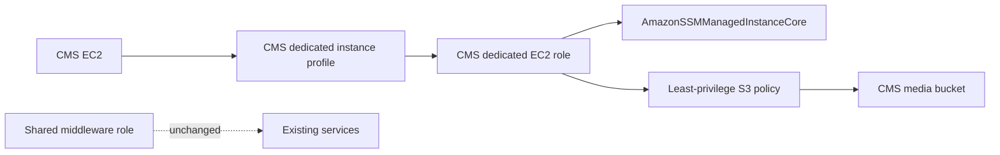
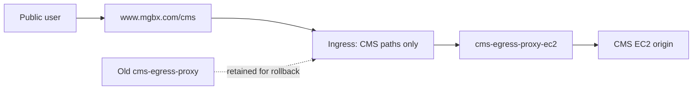

# CMS EC2 迁移与官网代理接入：脱敏运维归档

> 这是供团队回顾证据、链路与决策的完整脱敏归档，不是原始文件的逐字副本。
> 原始资料仅保留在本机受控目录，**不得**提交到 Git。本文保留真实排障顺序、资源关系、验证项和回滚动作；仅将账号、凭证及高攻击面资源标识替换为变量名。

## 归档说明

| 项目 | 内容 |
| --- | --- |
| 原始资料 | OpenClaw workspace 中的 2026-09-21 CMS 迁移 Review（本机受控，不入库） |
| 资料用途 | 团队复盘、变更交接、后续 Wiki 提炼 |
| 已保留 | 域名、公开访问路径、资源类型、代理与 Ingress 名称、验证结果、命令形态 |
| 已替换 | `<AWS_ACCOUNT_ID>`、`<AWS_PROFILE_NAME>`、`<CMS_INSTANCE_ROLE_ARN>`、`<CMS_INSTANCE_PROFILE_ARN>`、`<EKS_CLUSTER_ARN>`、各类密钥/令牌/密码 |
| 复核要求 | 如需精确 ARN、账号或凭证，须通过受控的云账号/密钥系统按权限只读获取，不从 Git 历史查找 |

## TL;DR

本次变更从替换 CMS EC2、接入 `cms.mg56.net`、在 AWS 新建 CMS 专用资源开始；随后将 `www.mgbx.com/cms` 经 EKS 内的专用代理接入新 CMS，并修复路径重写导致的静态资源异常。

核心策略是“隔离新增、最小切换”：不修改共享 IAM role，不切换官网主入口，不删除旧代理，只调整两个 CMS Ingress backend，因此可快速回退。

## 1. 范围与非目标

### 本轮完成目标

- 新 CMS EC2 通过 `cms.mg56.net` 提供入口。
- 新建或校验 CMS 专用 S3 bucket、EC2 role / instance profile，并保持最小 S3 权限。
- 在 EKS 新增 `cms-egress-proxy-ec2`，仅将 CMS 子路径后端切到该代理。
- 验证 CMS 页面、分页、CSS 与 JavaScript 静态资源。

### 明确不做

- 不切换 `www.mgbx.com` 主入口，不改 Global Accelerator、NLB 或 ingress-nginx 主链路。
- 不修改共享 instance role `mgbx-middleware-ssm-role`，不删除旧 `cms-egress-proxy`。
- 不重构 WAF 为 Rule Group；不创建或切换 S3 Gateway VPC Endpoint。

## 2. 操作入口与风险边界

AWS 侧操作在受控远端主机完成；本机不保存目标 profile。非交互 shell 可能缺少 PATH，因此执行前确认 AWS CLI 和 kubectl 的绝对路径。

| 资源 | 决策 | 原因 |
| --- | --- | --- |
| EC2 role / instance profile | 新建 CMS 专用资源 | 不影响现有服务 |
| S3 bucket | 新建 CMS 专用 bucket | 隔离媒体文件与权限 |
| CloudFront | 可新建专用 distribution | 降低路径和缓存策略耦合 |
| EKS proxy | 新增 `cms-egress-proxy-ec2` | 保留旧代理以便回滚 |
| Ingress | 只改两个 CMS backend | 主站与其他路径不受影响 |

## 3. AWS 资源准备与权限关系

目标实例、VPC、子网、安全组、DNS、ALB/target group、WAF 关联关系均应在变更前只读核验。精确资源 ARN 与账号 ID 不在本文保留。

S3 bucket 命名中原账号段替换为：`cms-media-<AWS_ACCOUNT_ID>-0920`。bucket 保持私有；应用仅经 CMS instance role 获得目标 bucket 必需的 `ListBucket`、`GetObject`、`PutObject` 权限，不默认授予删除权限。对外媒体访问优先使用 CloudFront OAC 或受控应用代理。



CloudFront 如创建，应记录其精确标识于受控资产系统；Git 中只使用 `<CLOUDFRONT_DISTRIBUTION_ID>` 或 `<CLOUDFRONT_DISTRIBUTION_ARN>`。S3 Gateway VPC Endpoint 需单独评估路由表和 endpoint policy，未纳入本轮。

## 4. CMS 新入口链路

`cms.mg56.net` 指向新 CMS 入口。变更前后均应核验 DNS、ALB listener/target health、WAF Web ACL 关联和源站响应。WAF 复用或关联应以实际 Web ACL 规则及日志为准，本文不存储 `<WAF_WEB_ACL_ARN>`。

建议验证：

```bash
aws elbv2 describe-load-balancers --profile <AWS_PROFILE_NAME>
aws elbv2 describe-target-health --profile <AWS_PROFILE_NAME> --target-group-arn <TARGET_GROUP_ARN>
aws wafv2 list-resources-for-web-acl --profile <AWS_PROFILE_NAME> --web-acl-arn <WAF_WEB_ACL_ARN> --resource-type APPLICATION_LOAD_BALANCER
```

## 5. 官网 `/cms` 旧链路与新增代理

旧链路在切换前保持可用并完成只读检查。新链路不直连主站入口，而是在 EKS 中新增 `cms-egress-proxy-ec2`，将 CMS 请求转发至新源站；随后只切两个 CMS 相关 Ingress backend。



部署前应记录 namespace、deployment、service、ingress 名称与变更前 backend；`<EKS_CLUSTER_ARN>`、控制面 endpoint、集群凭证等不进入归档。保留的可读检查形式如下：

```bash
kubectl --context <KUBECTL_CONTEXT> get deploy,svc,ingress -n <CMS_NAMESPACE>
kubectl --context <KUBECTL_CONTEXT> describe ingress <CMS_INGRESS_NAME> -n <CMS_NAMESPACE>
kubectl --context <KUBECTL_CONTEXT> get endpoints <CMS_PROXY_SERVICE> -n <CMS_NAMESPACE>
```

## 6. 路径与静态资源故障定位

首次切换后，页面 HTML 可加载但 `/cms/public/...` 下的 CSS、JavaScript 出现 404 或样式异常。排查表明问题在 Ingress rewrite 与上游应用路径预期不一致，而不是 CMS 源站不可用。

修复原则：

- 将 `/cms/` 的路径重写、尾部斜杠跳转和静态资源前缀作为同一组验证对象。
- 检查代理传递的 Host header；选择与源站路由和应用生成 URL 一致的值。
- 不通过修改主站或全局 Ingress 行为来修复 CMS 子路径问题。

## 7. 验证结果与证据

完成切换和修复后，以下结果已作为本次复盘的有效证据：

| 范围 | 验证结论 |
| --- | --- |
| AWS / CMS 源站 | 新实例可用，专用 instance profile 与最小 S3 权限符合预期 |
| EKS | 新代理资源与 endpoints 正常；仅 CMS backend 完成切换 |
| 公网页面 | `www.mgbx.com/cms/news`、分页及 CSS/JS 静态资源返回成功响应 |
| 隔离性 | 官网主入口、旧代理和共享 IAM role 未被本次变更修改 |

建议使用下列可复现检查（实际 host、账号和资源标识从受控系统解析）：

```bash
aws sts get-caller-identity --profile <AWS_PROFILE_NAME>
aws ec2 describe-instances --profile <AWS_PROFILE_NAME> --instance-ids <CMS_EC2_INSTANCE_ID>
aws s3api head-bucket --profile <AWS_PROFILE_NAME> --bucket cms-media-<AWS_ACCOUNT_ID>-0920
aws iam get-instance-profile --profile <AWS_PROFILE_NAME> --instance-profile-name <CMS_INSTANCE_PROFILE_NAME>
curl -I https://www.mgbx.com/cms/news
curl -I https://www.mgbx.com/cms/public/<STATIC_ASSET_PATH>
```

## 8. 回滚与交接

若官网 CMS 路径异常，优先将两个 CMS Ingress backend 恢复到变更前记录的旧代理；验证恢复后再定位新代理、路径重写或 Host header。AWS 专用资源若已被绑定，先切回变更前 instance profile；新 role/profile 保留观察期后再按变更流程清理。

| 症状 | 首先检查 | 处置方向 |
| --- | --- | --- |
| CMS 上传失败 | 专用 role 的目标 bucket 权限 | 校验 List/Get/Put 范围 |
| SSM 登录失败 | instance profile 与 SSM policy | 校验专用 role 附加策略 |
| 页面样式异常 | rewrite、`/cms/public`、Host header | 修复 CMS 专属代理规则 |
| CMS 页面不可用 | Ingress backend、proxy endpoints、源站 health | 先回滚两个 CMS backend |

## 9. 后续建议

1. 将 CloudFront、IAM role/profile、EKS resource 的精确标识维护在权限受控资产清单，不写入仓库。
2. 每次同类切换在 review 中附上变更前 backend 与验证时间；将可复用的路径重写检查沉淀到 Wiki。
3. S3 Gateway VPC Endpoint 若要推进，单开变更窗口并完成路由表、DNS 和 endpoint policy 影响评估。
4. 本文衍生的结论文档为 `reviews/2026/2026-09-26-cms-migration-proxy-cutover.md`；其适合快速阅读，本文保留更完整的操作证据。
