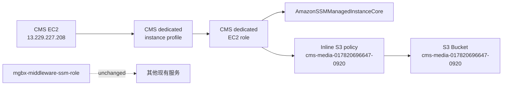
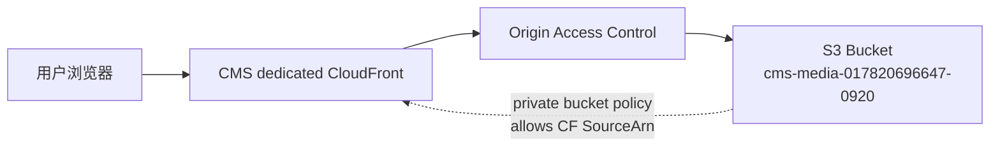
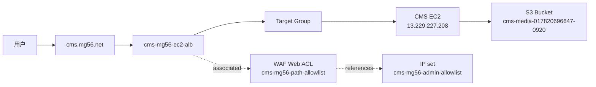
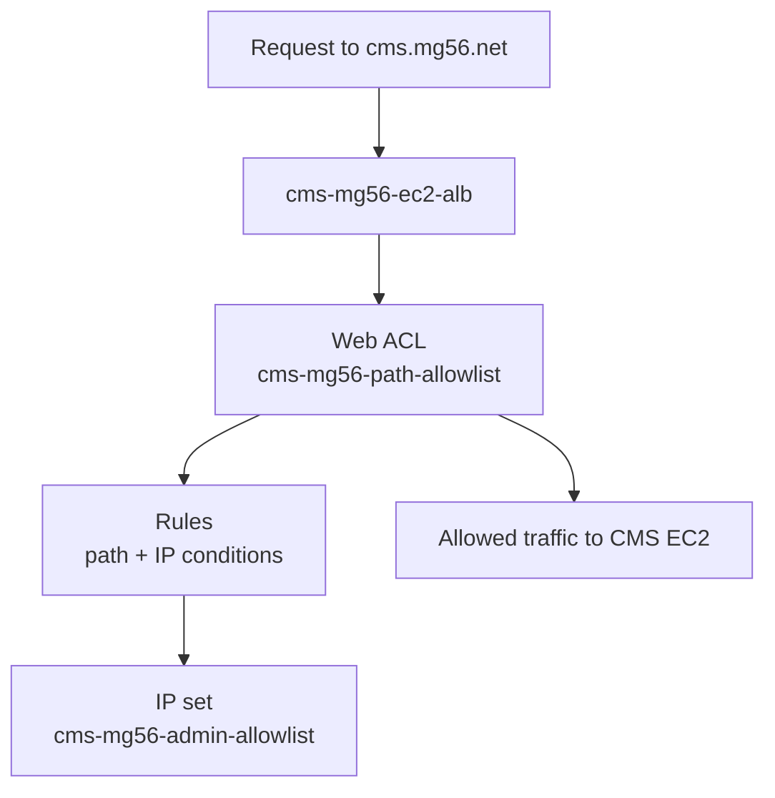
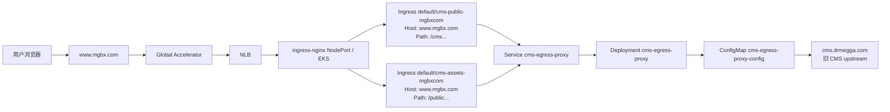
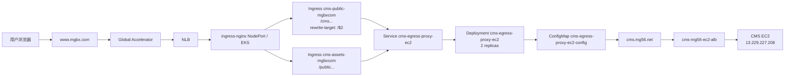
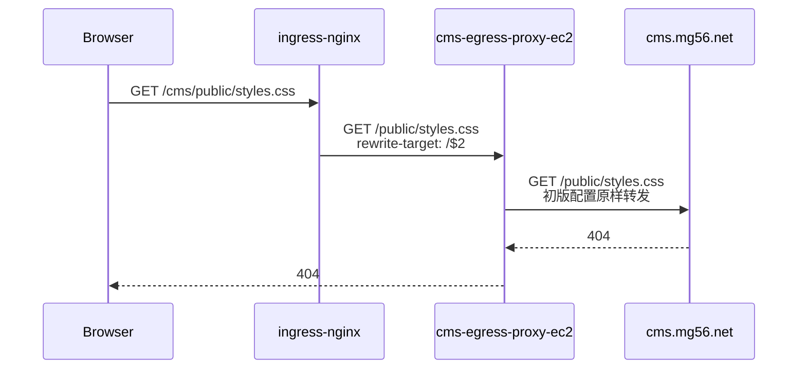
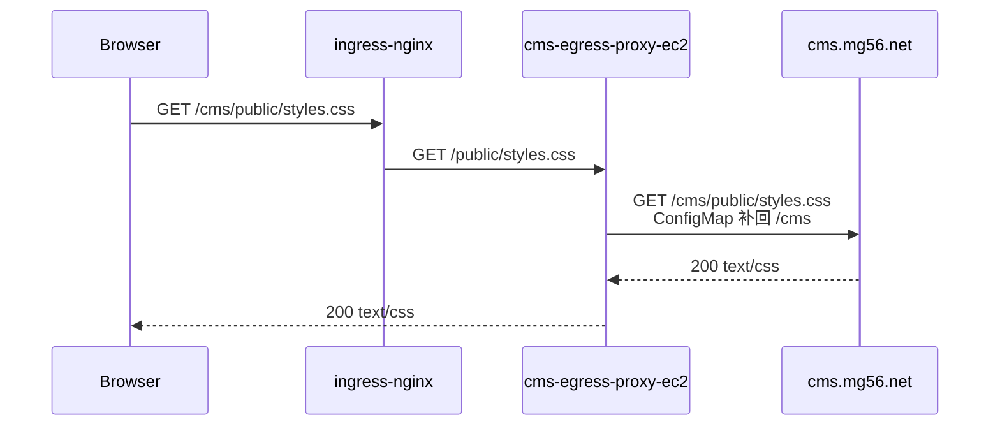

# MGBX CMS EC2 迁移与官网代理接入 Review（2026-09-21）

## TL;DR

本 review 覆盖范围从“更换 CMS EC2、使用 `cms.mg56.net`、在 AWS 侧新建 CMS 专用资源”开始，到后续 `www.mgbx.com/cms` 通过 EKS 代理接入新 CMS、再到页面样式异常修复为止。

本轮工作核心原则是隔离新增、最小切换：

- AWS 侧围绕新 CMS EC2 `13.229.227.208` 检查并准备新资源。
- 新建 CMS 专用 S3 Bucket：`cms-media-017820696647-0920`。
- 新建 CMS 专用 EC2 instance role / instance profile，不直接修改共享角色 `mgbx-middleware-ssm-role`。
- 为新 role 授权 SSM 与目标 S3 权限。
- 可创建 CMS 专用 CloudFront；本轮明确暂不处理 S3 Gateway VPC Endpoint。
- `cms.mg56.net` 使用新 CMS 入口链路，并复用/关联 WAF Web ACL。
- `www.mgbx.com/cms` 不直接切官网主入口，而是在 EKS 内新增 `cms-egress-proxy-ec2` 后只切两个 CMS Ingress backend。
- 修复 Ingress rewrite 导致的 `/cms/public/...` 静态资源 404 / 页面样式异常。

> 说明：本地记忆索引在重写本文档时处于暂停状态，OpenClaw 提示原因为 `index provenance classifier changed`。本文依据当前会话上下文和本地已有 review 文档重写；如需补齐 CloudFront distribution ID、IAM role ARN、instance profile ARN 等精确字段，建议在 `aws-macmini` 上用 `macmini-mgbx-operator` profile 做一次只读资源清单导出后追加。

---

## 1. Review 范围

### 1.1 起点

本 review 的起点不是“官网代理切换”，而是以下任务开始：

- CMS 更换到 EC2：
  - EC2 公网 IP：`13.229.227.208`
  - 域名：`cms.mg56.net`
- AWS 操作入口：
  - 本地没有目标 AWS profile
  - 需 SSH 到 macmini：`ssh aws-macmini`
  - 在远端使用 profile：`macmini-mgbx-operator`
- 需要检查 AWS 侧服务资源。
- 允许执行：
  - 新建 CMS 专用 Bucket：`cms-media-017820696647-0920`
  - 新建 EC2 instance role / instance profile
  - 不直接修改共享 role：`mgbx-middleware-ssm-role`
  - 给新 CMS role 添加 SSM 权限和 S3 权限
  - 可以创建 CMS 专用 CloudFront
  - 暂时不处理 S3 Gateway VPC Endpoint

### 1.2 终点

本 review 的终点是：

- `cms.mg56.net` 新链路可访问。
- `www.mgbx.com/cms` 官网内 CMS 子路径切到新 CMS 链路。
- 页面样式异常修复。
- 验证 `www.mgbx.com/cms/news`、分页、CSS/JS 静态资源均返回 200。

### 1.3 明确不在本轮处理的事项

- 不切换 `www.mgbx.com` 官网主入口。
- 不改 Global Accelerator / NLB / EKS ingress-nginx 主链路。
- 不直接修改共享 instance role `mgbx-middleware-ssm-role`。
- 不删除旧 `cms-egress-proxy`。
- 不重构 WAF 为 Rule Group。
- 暂不创建或切换 S3 Gateway VPC Endpoint。

---

## 2. 操作入口与账号边界

### 2.1 管理入口

本地环境不存在 `macmini-mgbx-operator` profile，因此 AWS 侧检查和变更需要在远端 macmini 执行：

```bash
ssh aws-macmini
```

远端使用：

```bash
aws --profile macmini-mgbx-operator ...
```

实际执行时还遇到过非交互 shell 的 PATH 问题：

- `aws` 不一定在默认 PATH。
- 远端 AWS CLI 可使用绝对路径，例如 `/opt/homebrew/bin/aws`。
- `kubectl` 也建议先定位绝对路径后再执行。

### 2.2 操作风险控制

本轮所有高风险资源都采用“新增专用资源，不改共享资源”的方式：

| 资源类型 | 策略 | 原因 |
|---|---|---|
| EC2 role | 新建 CMS 专用 role | 避免修改 `mgbx-middleware-ssm-role` 影响其他机器 |
| Instance profile | 新建 CMS 专用 profile | 便于只影响 CMS EC2 |
| S3 Bucket | 新建 CMS 专用 bucket | 降低与其他业务媒体资源耦合 |
| CloudFront | 可新建 CMS 专用 distribution | 避免复用现有 distribution 带来路径/缓存策略耦合 |
| EKS proxy | 新建 `cms-egress-proxy-ec2` | 保留旧 proxy，便于快速回滚 |
| Ingress | 只改两个 CMS Ingress backend | 不影响官网首页和其他路径 |

---

## 3. AWS 侧资源准备

### 3.1 目标 EC2

本轮 CMS 使用新 EC2：

- Public IP：`13.229.227.208`
- 服务域名：`cms.mg56.net`
- AWS profile：`macmini-mgbx-operator`
- 管理入口：`aws-macmini`

前置检查应包括：

- 目标 EC2 instance ID、VPC、subnet、security group。
- 当前 instance profile / role。
- 是否仍绑定共享 role `mgbx-middleware-ssm-role`。
- 出站访问 S3 / Internet / NAT / Endpoint 的路径。
- `cms.mg56.net` 当前 DNS 记录。
- ALB / target group / listener / health check。
- WAF Web ACL 关联关系。

### 3.2 S3 Bucket

创建 CMS 专用 bucket：

```text
cms-media-017820696647-0920
```

推荐配置原则：

- Bucket 保持私有。
- 不使用 public ACL。
- 不给全局公开读写 bucket policy。
- 应用写入只通过 CMS EC2 instance role。
- 对外公开访问优先通过 CloudFront OAC 或应用受控代理。

推荐权限边界：

| 动作 | 说明 |
|---|---|
| `s3:ListBucket` | 限定在目标 bucket，必要时限定 prefix |
| `s3:GetObject` | CMS 读取媒体文件 |
| `s3:PutObject` | CMS 上传媒体文件 |
| `s3:DeleteObject` | 本轮未明确要求，不建议默认给 |

### 3.3 EC2 Instance Role

用户明确要求不要直接修改：

```text
mgbx-middleware-ssm-role
```

因此应新建 CMS 专用 EC2 role / instance profile。

新 role 需要至少包含：

- EC2 trust policy：
  - Principal：`ec2.amazonaws.com`
- SSM 权限：
  - 用于保留 Session Manager / 运维登录能力
  - 通常可使用 `AmazonSSMManagedInstanceCore`
- S3 权限：
  - 仅限 `cms-media-017820696647-0920`
  - 只给业务需要的 List/Get/Put



### 3.4 CloudFront

本轮允许创建 CMS 专用 CloudFront，用于未来媒体公开访问或边缘加速。

推荐关系：



注意事项：

- 如果 CloudFront 使用自定义域名，需要 `us-east-1` ACM 证书。
- 不应为了公开媒体而直接开放 S3 bucket。
- CloudFront bucket policy 应限制到指定 distribution ARN。
- DNS 切换应等 CloudFront `Deployed` 且应用配置准备好后再做。

### 3.5 本轮暂不处理 S3 Gateway VPC Endpoint

S3 Gateway VPC Endpoint 可以降低公网/NAT 依赖，但用户明确要求“暂时不处理”。

后续如果处理，需要单独评估：

- EC2 所在 VPC route table。
- Endpoint policy。
- 是否影响同 VPC 内其他实例访问 S3。
- 应用侧对 S3 region endpoint 的使用方式。

---

## 4. `cms.mg56.net` 新 CMS 入口链路

### 4.1 新链路



### 4.2 WAF 关系

`cms-mg56-path-allowlist` 是 WAF Web ACL，不是单独的 IP set。

`cms-mg56-admin-allowlist` 是 IP set，只保存允许 IP 列表，不能独立生效。它需要被 Web ACL 内的 rule 引用后，才会在 ALB 上产生访问控制效果。

本轮做法是复用/关联现有 Web ACL 到新 ALB，避免在迁移窗口重新设计访问控制。



### 4.3 验证项

已验证：

- `https://cms.mg56.net/cms/news` 返回 200。
- 新 ALB 链路可作为 EKS proxy 的上游。

后续交接建议补充确认：

```bash
aws elbv2 describe-load-balancers --profile macmini-mgbx-operator
aws elbv2 describe-target-health --profile macmini-mgbx-operator --target-group-arn <target-group-arn>
aws wafv2 list-resources-for-web-acl --profile macmini-mgbx-operator --web-acl-arn <web-acl-arn> --resource-type APPLICATION_LOAD_BALANCER
curl -I https://cms.mg56.net/cms/news
```

---

## 5. `www.mgbx.com/cms` 旧链路确认

### 5.1 旧链路

`www.mgbx.com` 没有直接走 `cms-mg56-ec2-alb`，而是：



### 5.2 只读检查结论

检查发现：

- `cms.mg56.net` 已经走新 EC2 ALB。
- `www.mgbx.com/cms` 仍在 EKS 中走旧 `cms-egress-proxy`。
- 旧 ConfigMap upstream 仍是：
  - `cms.drmegga.com`
- `https://www.mgbx.com/cms/` 还存在不干净跳转：
  - `http://www.mgbx.com:8080/cms/cms/news`

结论：

`cms.mg56.net` 切换不会自动影响 `www.mgbx.com/cms`。官网内 CMS 子路径需要单独处理 EKS proxy 链路。

---

## 6. EKS 侧隔离新增代理

### 6.1 选择方案

采用方案 1：新建一套代理资源，再切 Ingress backend。

| 方案 | 影响面 | 回滚 | 结论 |
|---|---|---|---|
| 新建 `cms-egress-proxy-ec2` 后切两个 Ingress | 只影响 CMS 子路径 | 改回 backend 即可 | 已采用 |
| 直接改旧 `cms-egress-proxy-config` | 影响所有旧 proxy 调用方 | 需要恢复旧 ConfigMap | 未采用 |
| `www.mgbx.com` 直接切到新 ALB | 影响官网主入口 | 风险高 | 未采用 |

### 6.2 新增资源

新增：

- `ConfigMap/default/cms-egress-proxy-ec2-config`
- `Deployment/default/cms-egress-proxy-ec2`
- `Service/default/cms-egress-proxy-ec2`

基线与备份：

- EKS context：`arn:aws:eks:ap-southeast-1:931324892624:cluster/mgbx`
- 旧 `Deployment/cms-egress-proxy`：`2/2 Ready`
- 远端备份目录：

```text
/Users/mgbx/k8s-backups/cms-egress-proxy-ec2-20260921-101312
```

设计细节：

- 复用旧 proxy 的 nginx 结构、探针、资源参数。
- 更换 upstream、Host、SNI 到 `cms.mg56.net`。
- 新 Service selector 与旧 Service 隔离。
- 旧 proxy 保留不动。

### 6.3 切换 Ingress backend

只替换两个 Ingress 的 backend service name：

- `cms-assets-mgbxcom`
  - `cms-egress-proxy` -> `cms-egress-proxy-ec2`
- `cms-public-mgbxcom`
  - `cms-egress-proxy` -> `cms-egress-proxy-ec2`

未修改：

- Host
- Path
- Ingress annotation
- ingress-nginx 主入口
- Global Accelerator / NLB

### 6.4 最终官网 CMS 链路



---

## 7. 路径与样式异常修复

### 7.1 第一次切换后的问题

切到新 proxy 后：

- `www.mgbx.com/cms/news` 初始出现 404。
- 原因是 `cms-public-mgbxcom` 有 rewrite，`/cms/news` 到 proxy 内部变成 `/news`。
- 新 EC2 CMS 需要完整 `/cms/news`。

修复方式：

- 在 `cms-egress-proxy-ec2-config` 内补偿路径。
- 对进入 proxy 的非 `/cms` 请求补回 `/cms` 前缀。

### 7.2 `/cms/` 跳转问题

`/cms/` 曾由后端返回：

```text
http://www.mgbx.com:8080/cms/cms/news
```

`proxy_redirect` 在变量 `proxy_pass` 场景下未能稳定修正该 Location。

最终采用更稳的方式：

- 在新 proxy 内对入口路径直接处理。
- 对被 rewrite 后进入 proxy 的 `/` 返回：

```text
302 https://www.mgbx.com/cms/news
```

这样避免后端绝对跳转透出 `:8080` 和双 `/cms/cms`。

### 7.3 页面样式异常

用户反馈访问 `www.mgbx.com/cms` 后页面样式不对。

排查发现：

- HTML 页面能返回。
- 但 CSS/JS 在 `www` 侧 404：
  - `/cms/public/styles.css`
  - `/cms/public/cms-public.js`
- 同样路径在 `cms.mg56.net` 源站返回 200。

根因：



修复：

```text
~^/public(?:/|$) $request_uri;
```

改为：

```text
~^/public(?:/|$) /cms$request_uri;
```

修复后：



### 7.4 Host header 选择

用户建议中提到在 `www.mgbx.com` Nginx 中设置：

```nginx
proxy_set_header Host $host;
```

本轮没有采用该点，原因：

- 当前上游是 `cms.mg56.net` / `cms-mg56-ec2-alb`。
- 保留 `Host: cms.mg56.net` 和 SNI 更利于 ALB host-based rule、TLS SNI、后端虚拟主机匹配。
- 实际故障点是路径前缀丢失，不是 Host header。

---

## 8. 验证结果

### 8.1 AWS / CMS 源站

已验证：

- `https://cms.mg56.net/cms/news` -> `200`

建议后续补充：

- EC2 instance profile 已是 CMS 专用 profile。
- 新 role 具备 SSM 权限。
- 新 role 对 `cms-media-017820696647-0920` 具备预期 S3 权限。
- CloudFront 若已创建，确认 status 为 `Deployed`。
- S3 bucket policy 不公开，且只授权预期 role / CloudFront distribution。

### 8.2 EKS 资源

已验证：

- `Deployment/cms-egress-proxy-ec2`：`2/2 Ready`
- `Service/cms-egress-proxy-ec2`：正常
- `ConfigMap/cms-egress-proxy-ec2-config`：读回确认 `/public...` 补 `/cms` 前缀
- 旧 `Deployment/cms-egress-proxy`：保留未动

### 8.3 公网 HTTP

已验证：

- `https://www.mgbx.com/cms/news` -> `200`
- `https://www.mgbx.com/cms/news?page=2` -> `200`
- `https://www.mgbx.com/cms/` -> 跳转到 `/cms/news` 后 `200`
- `https://www.mgbx.com/cms/public/styles.css...` -> `200`
- `https://www.mgbx.com/cms/public/cms-public.js...` -> `200`
- `https://www.mgbx.com/cms/public/official-header-adapter.js...` -> `200`
- `https://cms.mg56.net/cms/news` -> `200`

仍需注意：

- 如果某些 API 或资源在 `cms.mg56.net` 源站本身就是 404，那么 `www.mgbx.com` 侧保持 404 是正常透传，不属于 EKS proxy 问题。

---

## 9. 回滚方案

### 9.1 官网 CMS 代理回滚

最快回滚是把两个 Ingress backend 改回旧 Service：

```bash
kubectl -n default patch ingress cms-assets-mgbxcom --type=json -p='[{"op":"replace","path":"/spec/rules/0/http/paths/0/backend/service/name","value":"cms-egress-proxy"}]'
kubectl -n default patch ingress cms-public-mgbxcom --type=json -p='[{"op":"replace","path":"/spec/rules/0/http/paths/0/backend/service/name","value":"cms-egress-proxy"}]'
```

影响：

- `www.mgbx.com/cms` 回到旧 `cms-egress-proxy`。
- 旧 upstream 为 `cms.drmegga.com`。
- 新 `cms-egress-proxy-ec2` 可保留，不影响旧链路。

### 9.2 AWS 侧回滚思路

AWS 侧因为采用新增专用资源，回滚时优先做“解绑/停用”，不要直接删除：

- EC2 如已切换到 CMS 专用 instance profile，可按变更前记录切回旧 profile。
- 新 role / instance profile 先保留观察，不立即删除。
- S3 bucket 如果已有上传对象，不删除；先停止应用写入并备份对象清单。
- CloudFront 如果已建成但尚未切 DNS，可保留或 disable。
- WAF Web ACL 不建议在回滚时重构，只确认 ALB 关联关系恢复预期。

---

## 10. 运维交接命令

### 10.1 AWS 侧检查

在远端执行：

```bash
ssh aws-macmini
```

示例检查：

```bash
/opt/homebrew/bin/aws sts get-caller-identity --profile macmini-mgbx-operator
/opt/homebrew/bin/aws ec2 describe-instances --profile macmini-mgbx-operator --filters "Name=ip-address,Values=13.229.227.208"
/opt/homebrew/bin/aws s3api head-bucket --profile macmini-mgbx-operator --bucket cms-media-017820696647-0920
/opt/homebrew/bin/aws iam list-instance-profiles --profile macmini-mgbx-operator
/opt/homebrew/bin/aws cloudfront list-distributions --profile macmini-mgbx-operator
```

### 10.2 EKS 侧检查

```bash
kubectl -n default get deploy cms-egress-proxy cms-egress-proxy-ec2
kubectl -n default get svc cms-egress-proxy cms-egress-proxy-ec2
kubectl -n default describe ingress cms-assets-mgbxcom
kubectl -n default describe ingress cms-public-mgbxcom
kubectl -n default get configmap cms-egress-proxy-ec2-config -o yaml
```

### 10.3 HTTP 检查

```bash
curl -I https://cms.mg56.net/cms/news
curl -I https://www.mgbx.com/cms/news
curl -I 'https://www.mgbx.com/cms/news?page=2'
curl -I https://www.mgbx.com/cms/public/styles.css
curl -I https://www.mgbx.com/cms/public/cms-public.js
```

---

## 11. 故障定位表

| 现象 | 优先判断 | 检查方向 |
|---|---|---|
| `cms.mg56.net` 访问失败 | AWS / ALB / EC2 / 应用问题 | ALB target health、EC2 服务、SG、WAF |
| `cms.mg56.net` 200，`www.mgbx.com/cms` 404 | EKS proxy 或 Ingress rewrite 问题 | `cms-public-mgbxcom`、`cms-egress-proxy-ec2-config` |
| HTML 200，CSS/JS 404 | 静态资源路径前缀丢失 | `/cms/public/...` 是否被 rewrite 成 `/public/...` 后未补 `/cms` |
| `/cms/` 跳到 `:8080` 或 `/cms/cms/news` | 后端绝对跳转透出 | proxy 入口 `location = /` / redirect 规则 |
| 403 | WAF / IP allowlist | `cms-mg56-path-allowlist`、`cms-mg56-admin-allowlist`、来源 IP |
| CMS 上传媒体失败 | EC2 role S3 权限 | 新 CMS role 是否允许目标 bucket List/Get/Put |
| S3 对外 URL 访问失败 | CloudFront / bucket policy | Distribution status、OAC、bucket policy SourceArn |
| SSM 登录失败 | EC2 instance profile / SSM 权限 | CMS role 是否有 `AmazonSSMManagedInstanceCore` |

---

## 12. 后续建议

1. 补一份 AWS 实物清单，记录：
   - CMS EC2 instance ID
   - CMS role / instance profile 名称与 ARN
   - S3 bucket policy
   - CloudFront distribution ID / domain / status
   - ALB ARN / target group ARN / WAF Web ACL ARN
2. 将 `cms-egress-proxy-ec2-config` 纳入 GitOps 或配置仓库，避免 live-only 配置不可追溯。
3. 为 `www.mgbx.com/cms` 加合成监控：
   - `/cms/news`
   - `/cms/news?page=2`
   - `/cms/public/styles.css`
   - `/cms/public/cms-public.js`
4. 保留旧 `cms-egress-proxy` 至少一个观察周期，确认没有回滚需求后再评估清理。
5. S3 Gateway VPC Endpoint 后续如要处理，单独开变更窗口，先做 route table / endpoint policy 影响评估。
6. WAF Rule Group 化可以作为后续治理项，不建议和迁移窗口耦合。

---

## 13. 关键资产索引

### AWS

- CMS EC2：
  - `13.229.227.208`
- CMS 域名：
  - `cms.mg56.net`
- S3 Bucket：
  - `cms-media-017820696647-0920`
- 旧共享 role：
  - `mgbx-middleware-ssm-role`
- 新 ALB：
  - `cms-mg56-ec2-alb`
- WAF Web ACL：
  - `cms-mg56-path-allowlist`
- WAF IP set：
  - `cms-mg56-admin-allowlist`
- AWS profile：
  - `macmini-mgbx-operator`
- 管理机器：
  - `aws-macmini`

### Kubernetes

- Cluster：
  - `arn:aws:eks:ap-southeast-1:931324892624:cluster/mgbx`
- Namespace：
  - `default`
- 旧 proxy：
  - `Deployment/cms-egress-proxy`
  - `Service/cms-egress-proxy`
  - `ConfigMap/cms-egress-proxy-config`
- 新 proxy：
  - `Deployment/cms-egress-proxy-ec2`
  - `Service/cms-egress-proxy-ec2`
  - `ConfigMap/cms-egress-proxy-ec2-config`
- Ingress：
  - `cms-assets-mgbxcom`
  - `cms-public-mgbxcom`
- 远端备份：
  - `/Users/mgbx/k8s-backups/cms-egress-proxy-ec2-20260921-101312`
